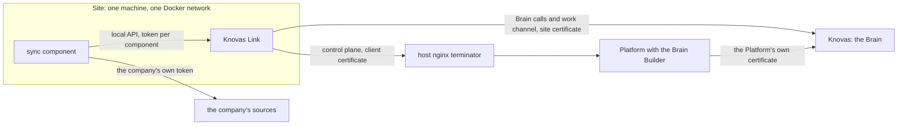

# The connection layer: the parts in this repository

How a company's sources are connected to its Brain, and which part of this repository does what. This page is the
entry point; it links to the pages that own each detail and repeats none of them. For setting up a site step by step
(in German, for consultants) read [connect-a-site.md](connect-a-site.md).

## In plain words

- A **site** is one machine at the company. On it runs **Knovas Link**, the only program there that talks to Knovas,
  and only outwards. Next to it run **components** that read the company's sources, today the **sync component**.
  The components talk only to Link.
- The **Brain Builder** (part of the Platform) is where a person sets everything up and watches it: the site and its
  install package, the sources and their two switches, the mappings, the approval of proposed changes, and the
  health of each site.
- Three things travel through a site:
  1. **Sync:** the sync component reads a source, plans what changes in the Brain, shows a dry run, and applies it
     after a person's approval.
  2. **Originals:** when an agent asks for an original document and may read it, Knovas asks the site; the sync
     component reads the file from the source, and its bytes pass through Link to the agent. Knovas does not store
     them.
  3. **Write back:** an agent may propose a change to a fact. A person accepts it in the Builder. The sync component
     then opens a pull request in the source. The Brain shows the new value only after the next sync reads it.
- The source's credentials stay at the site. They never pass through the Platform.

## The parts and where their code is

| Part | Runs | What it does | Code | Owner page |
|---|---|---|---|---|
| Knovas Link | the site | enrolment, the site's key and certificate, heartbeat, the components' Brain calls on an allow-list, the work channel (jobs) and probes, its local API | [`KnovasLink/`](../../KnovasLink/) | [Link README](../../KnovasLink/README.md); local API: [`KnovasLink/contracts/local-api.md`](../../KnovasLink/contracts/local-api.md) |
| Sync component, link mode | the site, beside Link | reads GitHub, HTTP/JSON and file shares; runs brain-runner; answers `fetch` (a GitHub blob) and `write` (a pull request) jobs | [`components/sync_component/`](../components/sync_component/) | [sync component README](../components/sync_component/README.md) |
| Brain Builder: sites | the Platform | the site page, its install package, «Token erneuern», the certificate step, «Jetzt prüfen» | `components/docbridge_integration/src/builder/sites.py` | [connect-a-site.md](connect-a-site.md) §§ 1–2 |
| Brain Builder: sources and switches | the Platform | per source «Agenten dürfen Originale abrufen» and «Änderungen dürfen zurückgeschrieben werden», both off until switched on and published | `builder/sources.py` | [connect-a-site.md](connect-a-site.md) § 3 |
| Brain Builder: mapping panels | the Platform | «Zugriff» (who reads the documents) and «Zurückschreiben» (which facts may travel back) | `builder/mapping_edits.py`, `builder/mappings.py` | [connect-a-site.md](connect-a-site.md) § 4 |
| Brain Builder: «Betrieb › Freigaben» | the Platform | accept or reject write proposals (permission «Veröffentlichen») | `builder/approvals.py`, `builder/connection_api.py` | [connect-a-site.md](connect-a-site.md) § 5 |
| Brain Builder: «Betrieb › Verbindung» | the Platform | one health card per site: green only after a probe went round in the last 10 minutes | `builder/sites.py`, `builder/connection_api.py` | [connect-a-site.md](connect-a-site.md) § 5 |
| Connector protocol, the Platform's side | the Platform | enrolment, heartbeat, configuration, package, commands, reports | `builder/protocol.py`, `web_interface/connector_protocol.py` | [connector-protocol-v1.md](connector-protocol-v1.md) |
| Client-certificate terminator | host nginx in front of the Platform | checks Link's certificate against the client CA and passes its SHA-256 as `X-Client-Cert-Fingerprint` | [`deploy/host-nginx/`](../deploy/host-nginx/) (`knovas-client-cert.js`, `knovas-connector-mtls.conf`); installed by `scripts/host-https.sh <fqdn> <email> <client CA>` (its header says how) | [connect-a-site.md](connect-a-site.md) § 2, «Der TLS-Terminator vor der Plattform» |
| Image release | GitHub Actions | builds, signs and pushes the Platform, `knovas-link` and `sync-component`; a site names them by digest | `.github/workflows/release-images.yml` | [deployment/release-images.md](deployment/release-images.md) |

The Brain's side (the `/secured/` routes Link calls: the work channel, the fetch of originals, source references, write
proposals) runs at Knovas. What a site must send and may expect is in [connector-protocol-v1.md](connector-protocol-v1.md),
from "Sites and Knovas Link" on.

## Who proves what

| From → to | Proof | Refused when |
|---|---|---|
| component → Link | `Authorization: Bearer <token>` (Link writes one per component to `/link/<component>/token`) and `X-Component` | the token does not belong to the name (401) |
| Link → Platform | the enrolment token once (24 hours, single use), then a control token and the certificate fingerprint the terminator sets | no certificate recorded yet: only the heartbeat is taken (`certificate_not_recorded`); no fingerprint: refused unless `BUILDER_CONNECTOR_REQUIRE_CLIENT_CERT=false` |
| Link → the Brain | the site's own client certificate (one per site), signed by Knovas's client CA | until it is installed Link claims no job and relays nothing (`waiting_for_certificate`); a path not on the allow-list is 403 `not_relayed` |
| the Platform → the Brain | the Platform's own client certificate, and the signed-in person's assertion | accepting a proposal needs «Veröffentlichen» in the Builder |
| sync component → source | the company's credential, `SYNC_CREDENTIAL_<KEY>` in `knovas-sources.env` | the source refuses it; a token that cannot write gives `token_cannot_write` |

The install package puts every service on the internal network `knovas-site` and on `knovas-egress` (to reach its own
sources). "Only Link talks to Knovas" holds because only Link holds a Knovas certificate and token, not because the
network is closed (`builder/sites.py`).

## Settings that turn parts on or off

| Setting | Effect | Default |
|---|---|---|
| Source switch «Agenten dürfen Originale abrufen» | Link passes `fetch` jobs for that source; otherwise `refused fetch_disabled` | off |
| Source switch «Änderungen dürfen zurückgeschrieben werden» (`access: read_write`) | Link passes `write` jobs; otherwise `refused write_disabled`. Offered for GitHub only, and only when the component declares `write:github` | off |
| `SYNC_LINK_URL` | the sync component runs in link mode (the install package sets it) | unset: direct mode |
| `BUILDER_CONNECTOR_REQUIRE_CLIENT_CERT` | the Platform requires the terminator's fingerprint on connector calls | `true` |
| `BUILDER_CONNECTOR_ISSUE_CERTIFICATES` | the Platform asks the Brain to sign a component's certificate at enrolment. Where the Brain cannot sign, set `false`: Knovas Link then waits for a certificate an admin signed | `true` |
| `BUILDER_CONNECTOR_CLIENT_CA` | the client CA Link learns at enrolment and a recorded site certificate must chain to | empty |
| `LINK_HEARTBEAT_SECONDS`, `LINK_PROBE_SECONDS` | heartbeat and probe intervals | 30, 300 |
| `LINK_TEST_ONLY_SHARED_CERTIFICATE` | test only, never for a company: Link uses the tenant's own certificate | off |

## What is built and what is not (2026-11-07)

- **Built on this branch, not deployed at any company:** Knovas Link, the sync component's link mode and its GitHub
  `fetch` and `write`, the Builder's sites, switches, panels, «Freigaben» and «Verbindung», the terminator, the release
  workflow.
- **No image is released yet.** GitHub offers the release workflow only once its file is on the default branch
  ([release-images.md](deployment/release-images.md), "Once per repository").
- **Images behind Link need brain-runner 0.3.1 or later.** The Platform's and the sync component's Dockerfiles pin
  0.3.1 (`BRAIN_RUNNER_VERSION`, `BRAIN_RUNNER_GIT_REF`) since 2026-11-07. Older releases (0.1.1, the pin before) cannot
  call the Brain through Link (`BRAIN_LOCAL_TOKEN`) and have no `compile-write`, so a sync component built with one
  cannot plan, apply or answer write jobs in link mode (sync component README, "Release coupling"). The release run
  prints the version in its step "Build and check the image".
- **Not built:** sources other than GitHub for `fetch` and `write`; the Knovas Connector behind Link; permissions from
  the source; credentials typed into the Builder; monitoring history and notifications; autonomous writes. The Builder
  records who accepted a proposal, but the Brain does not yet bind the accept to a verified person.
- **Known limits:** jobs of one tenant are not yet bound to one site, so add a second site only after that item; Link
  relays every method below `secured/graph/` ([connector-protocol-v1.md](connector-protocol-v1.md), "Sites and Knovas
  Link").

## Where to read next

- The contract between Link, the components and Knovas: [connector-protocol-v1.md](connector-protocol-v1.md) and
  [`KnovasLink/contracts/`](../../KnovasLink/contracts/).
- Setting up a site, in German: [connect-a-site.md](connect-a-site.md).
- Knovas Link: [`KnovasLink/README.md`](../../KnovasLink/README.md). The sync component:
  [`components/sync_component/README.md`](../components/sync_component/README.md).
- Releasing images and deploying them by digest: [deployment/release-images.md](deployment/release-images.md).
- HTTPS in front of the Platform: [deployment/host-nginx-internal.md](deployment/host-nginx-internal.md); the connectors'
  terminator: the header of `scripts/host-https.sh` and [connect-a-site.md](connect-a-site.md) § 2.
- Knovas's own deployment of the Platform and its site: [deployment/knovas-tenant.md](deployment/knovas-tenant.md)
  §§ 4–5.
